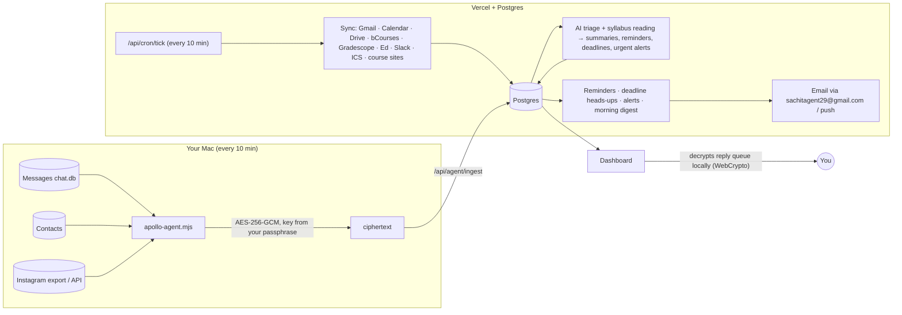

# Apollo

A private "second brain" dashboard: classes, messages, email, calendar, Drive and reminders in one place, with an AI agent that
reads incoming items, creates reminders, and sends a morning digest.

**→ [SETUP.md](SETUP.md)** walks through deploying to Vercel and connecting each account.

## What's on the dashboard

| Widget | Source |
|---|---|
| **Daily brief** | AI "top priorities" for the day + counts (due today, carried over, waiting on you, important unread) |
| **Today** | Timeline of today's events and deadlines, with a *now* marker |
| **Deadlines** | Assignments from bCourses, Gradescope and calendar feeds, grouped Overdue / Today / Tomorrow / This week / Later |
| **Reminders** | Two lists: *From your agent* (created from emails, announcements and Slack posts) and *Yours* (added by you) |
| **Reply queue** | People waiting on your reply on iMessage, Instagram and Slack. iMessage and Instagram names are end-to-end encrypted |
| **Class updates** | bCourses and Ed announcements, grades, course-site changes, class emails (incl. Pensieve/CalCentral notifications), filterable by course |
| **Inbox** | Email from every connected Google account, with AI summaries; Important / Unread / All |
| **Week ahead** | Seven-day view of events and deadlines |
| **Slack** | @-mentions and the announcement channels you pick |
| **Drive** | Recently edited and recently shared files |

Plus a **Classes** page (per-course assignments, announcements, grades), a **Digest** page (today's brief and history), and
**Settings** (notification email, digest time, alert rules, quiet hours, connections, Mac agent, widget layout, course names).

## Notifications

All email goes **from `sachitagent29@gmail.com`** to the address set in **Settings → General**
(default `sachitkumar2025@gmail.com`). Push notifications to your phone/browser are optional.

- **Morning digest** at your chosen time: schedule, carried-over items, due today, due this week, reminders, class updates,
  important email, and who's waiting on a reply. Every task has one-click *Mark done*, *Snooze a day*, and (for carried-over items)
  *Don't carry over* links.
- **Your reminders** arrive at the time you set, even during quiet hours.
- **Deadline heads-ups** 24h and 3h before each assignment (configurable).
- **Alerts** for whatever you turn on: new assignments, bCourses/Ed announcements, grades, course-site changes, Slack mentions,
  emails from specific senders or with keywords, and anything the agent flags as urgent. Non-urgent alerts wait out quiet hours and
  arrive batched into one email.

**Carry-over:** anything unfinished stays in the digest's *Carried over* section every morning until you mark it done, dismiss it,
or choose *Don't carry over* (in the email, or the ⋯ menu on the dashboard). Assignments stop carrying over a week after their deadline.

## How it works



- **Next.js 16** (App Router, server components, server actions) on Vercel, **Postgres** (Neon or Supabase), Tailwind CSS.
- **One scheduler endpoint** (`/api/cron/tick`) syncs whatever is due, runs AI triage, sends the digest once a day after your
  chosen time, and delivers reminders and alerts. Everything is idempotent, so a duplicate or late call is harmless.
- **AI agent:** Gemini (free tier; `gemini-flash-latest` by default) or Claude, with structured outputs. Incoming content is treated
  as untrusted data, and the agent can only write summaries, reminders, deadlines and alerts. It can't send anything on your behalf.
- **Syllabi & schedules:** bCourses syllabus pages, course websites and uploaded syllabi (PDF, text or link) are read for homework,
  project and exam dates, which become deadlines with reminders, without duplicating ones bCourses or Gradescope already track.

## Privacy and security

**Reply queue (iMessage + Instagram).** The Mac agent reads your messages *locally* and works out which conversations are waiting on
you, meaning the other person spoke last. Only `{ name, waiting since, unanswered count, "asked a question?" }` per conversation
leaves your Mac, and only as **AES-256-GCM ciphertext** encrypted with a key derived (PBKDF2, 600k iterations) from a passphrase that
never leaves your devices. Your browser decrypts it with WebCrypto; you can let it remember a non-extractable key on that device.
The server and the database only ever hold ciphertext plus a count. Message text is never uploaded, not even encrypted.
Snoozes are stored as opaque hashes keyed with a passphrase-derived secret, so the server can't tell who they refer to.
With the Instagram API option, the agent requests only sender and timestamp fields, never message content.

**Everything else:**
- **Sign in with Google**, and only allowlisted accounts get in: by default `sachitkumar2025@gmail.com` and `sachitk@berkeley.edu`
  (`ALLOWED_EMAILS`). The flow uses state, nonce and PKCE, and Google's signed ID token is verified. Sessions are signed, HttpOnly,
  Secure cookies (30 days), re-checked against the allowlist on every request.
- Every OAuth token, API token and the Gradescope password is encrypted at rest with AES-256-GCM (`ENCRYPTION_KEY`) and never
  sent to the browser. Google access is read-only.
- The scheduler and Mac agent authenticate with secrets; only the agent token's hash is stored.
- Email action links are signed, single-purpose, expire after 10 days, and need a confirm tap, so link scanners can't trigger them.
- Links from external sources are restricted to `http(s)`/`mailto`/`sms`.
- Email, announcement and Slack text you choose to triage, plus syllabi, is sent to the AI provider. On Gemini's free tier, Google may
  use it to improve its products; enabling billing on the key (or using Claude) avoids that. You can turn AI off per source in Settings.

## Project layout

```
agent/apollo-agent.mjs     Mac agent (zero dependencies): iMessage + Instagram → encrypted reply queue
db/migrations/            SQL schema (applied automatically on deploy)
src/app/(app)/            Dashboard, Classes, Digest, Settings pages
src/app/api/              cron tick, Google OAuth, Mac agent ingest, reply queue, push, email action links
src/lib/sources/          Connectors: google, canvas, gradescope, ed, slack, ics, webpage
src/lib/agent/            AI client (Gemini/Claude), triage, morning digest
src/lib/syllabus.ts       Syllabus and course-schedule reading
src/lib/notify/           Email (Gmail SMTP), push, templates, reminder/deadline/alert scheduler
src/components/           Widgets and UI
tests/                    Unit, integration (Postgres) and Mac-agent tests
```

## Development

See [SETUP.md → Local development](SETUP.md#local-development). `npm test` runs the test suite; `npm run lint` and `npm run typecheck`
keep things clean.
